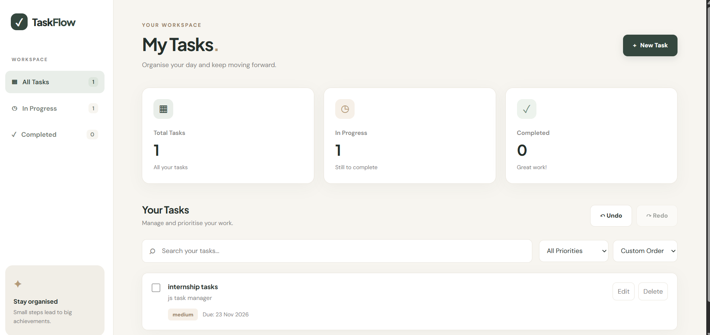

# TaskFlow — JavaScript Task Management Application

A responsive single-page task management application built with HTML, CSS, and Vanilla JavaScript (ES6+), without frameworks.

## Live Demo

[View Live Project](LIVE_DEMO_URL)

## Preview



## Features

- **CRUD Operations:** Create, view, edit, complete, and delete tasks.
- **Filtering & Sorting:** Filter by status and priority; sort by date, title, priority, or custom order.
- **URL Persistence:** Preserve filtering and sorting preferences through URL parameters.
- **Drag & Drop:** Reorder tasks using the HTML5 Drag and Drop API.
- **localStorage:** Save tasks across browser sessions with schema migration support.
- **Undo & Redo:** Command Pattern implementation with a 20-action history stack.
- **Debounced Search:** Search tasks with a 300ms delay and highlighted matches.
- **Keyboard Shortcuts:** Quick access to task creation, search, Undo, and Redo.
- **Responsive UI:** Accessible task modals and layouts for desktop, tablet, and mobile.

## Tech Stack

- HTML5
- CSS3
- JavaScript (ES6+)
- ES Modules
- HTML5 Drag and Drop API
- localStorage API
- History API / URLSearchParams

## Project Structure

```text
task-manager/
├── index.html
├── css/
│   └── style.css
├── js/
│   ├── main.js
│   ├── tasks.js
│   ├── ui.js
│   ├── storage.js
│   ├── filters.js
│   ├── search.js
│   ├── dragDrop.js
│   ├── commands.js
│   └── shortcuts.js
├── screenshots/
│   └── taskflow-dashboard.png
└── README.md
```

## Getting Started

1. Clone or download the repository.
2. Open the project folder in VS Code.
3. Run `index.html` using Live Server.

No npm installation or build process is required.

## Project Information

**Developer:** Delaram Farzad  
**Program:** Frontend Development Internship — Appverse Technologies  
**Phase:** Phase 1 — Web Foundations and JavaScript Mastery  
**Topic:** Async JavaScript and Modules  
**Project:** JavaScript Task Management Application

## Conclusion

TaskFlow demonstrates DOM manipulation, asynchronous JavaScript timers, ES modules, localStorage persistence, event handling, and the Command Pattern through a functional task management application.
